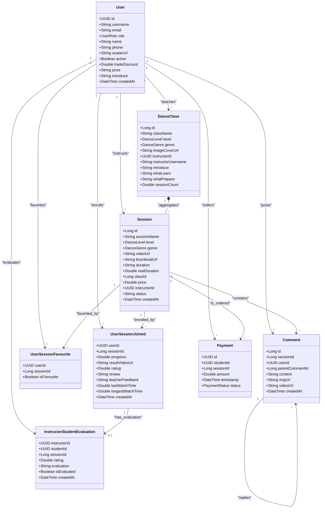

# Tài liệu Thiết kế & Sơ đồ Cơ sở Dữ liệu FOR DANCE (UML & ERD)

Tài liệu này tổng hợp toàn bộ cấu trúc cơ sở dữ liệu PostgreSQL (Supabase) của dự án **FOR DANCE**, bao gồm sơ đồ quan hệ thực thể (ERD), sơ đồ phân cấp lớp (UML Class Diagram), chi tiết các bảng, trường dữ liệu, ràng buộc khóa ngoại và ma trận bảo mật Row Level Security (RLS).

---

## 1. Sơ đồ Quan hệ Thực thể (Entity-Relationship Diagram - ERD)

Biểu đồ dưới đây mô tả trực quan 11 bảng trong database `public` schema cùng các mối quan hệ `1:N` và `N:M`:

```mermaid
erDiagram
    USERS ||--o{ CLASSES : "creates (instructor_id)"
    USERS ||--o{ SESSIONS : "teaches (instructor_id)"
    USERS ||--o{ COMMENTS : "writes (user_id)"
    USERS ||--o{ USERS_SESSIONS_JOINED : "registers (user_id)"
    USERS ||--o{ USERS_SESSIONS_FAVOURITE : "bookmarks (user_id)"
    USERS ||--o{ USERS_SESSIONS_REVIEWS : "rates (user_id)"
    USERS ||--o{ USERS_SESSIONS_PAYMENT : "pays (users_id)"
    USERS ||--o{ PAYMENTS : "initiates (student_id)"
    USERS ||--o{ INSTRUCTOR_PAYMENTS : "receives (instructor_id)"
    USERS ||--o{ INSTRUCTORS_STUDENTS_EVALUATION : "evaluates (instructor_id)"

    CLASSES ||--|{ SESSIONS : "contains (class_id)"
    SESSIONS ||--o{ COMMENTS : "has (session_id)"
    SESSIONS ||--o{ USERS_SESSIONS_JOINED : "enrolled_by (session_id)"
    SESSIONS ||--o{ USERS_SESSIONS_FAVOURITE : "favorited_by (session_id)"
    SESSIONS ||--o{ USERS_SESSIONS_REVIEWS : "reviewed_by (session_id)"
    SESSIONS ||--o{ USERS_SESSIONS_PAYMENT : "purchased (sessions_id)"
    SESSIONS ||--o{ PAYMENTS : "billed_for (session_id)"

    COMMENTS ||--o{ COMMENTS : "replies_to (parent_comment_id)"
    USERS_SESSIONS_JOINED ||--o{ INSTRUCTORS_STUDENTS_EVALUATION : "evaluated_in (student_id, session_id)"

    USERS {
        uuid id PK "Khóa chính - liên kết auth.users"
        text username "Tên tài khoản người dùng"
        text email "Email tài khoản"
        role role "Enum: admin | instructor | student"
        text name "Họ và tên đầy đủ"
        text phone "Số điện thoại"
        text avatar_url "Đường dẫn ảnh đại diện"
        boolean active "Trạng thái kích hoạt"
        float trade_discount "Chiết khấu thương mại"
        text prize "Giải thưởng của giảng viên"
        text introduce "Giới thiệu bản thân"
        timestamp created_at "Thời gian tạo tài khoản"
    }

    CLASSES {
        bigint id PK "Mã định danh lớp học (Identity)"
        uuid instructor_id FK "Giảng viên phụ trách"
        text class_name "Tên khóa học"
        level level "Enum: beginner | intermediate | advanced | mutilevel"
        genre genre "Enum: ballet | hiphop | folk | sexy..."
        text image_cover_url "Ảnh bìa khóa học"
        text instructor_username "Tên hiển thị giảng viên"
        text introduce "Giới thiệu khóa học"
        text what_learn "Kiến thức sẽ học"
        text what_prepare "Hành trang cần chuẩn bị"
        numeric session_count "Tổng số buổi học"
    }

    SESSIONS {
        bigint id PK "Mã định danh buổi học (Identity)"
        bigint class_id FK "Thuộc khóa học nào"
        uuid instructor_id FK "Giảng viên đứng lớp"
        text session_name "Tên buổi học"
        level level "Cấp độ bài học"
        genre genre "Thể loại vũ đạo"
        text video_url "URL video bài giảng"
        text thumbnail_url "Ảnh đại diện buổi học"
        text duration "Thời lượng bài giảng (text)"
        numeric real_duration "Thời lượng bài giảng (số phút)"
        numeric price "Giá bán buổi học"
        text status "Trạng thái buổi học"
        timestamp created_at "Ngày tạo"
    }

    COMMENTS {
        bigint id PK "Mã bình luận (Identity)"
        bigint session_id FK "Thuộc buổi học nào"
        uuid user_id FK "Người viết bình luận"
        bigint parent_comment_id FK "Bình luận cha (nếu là reply)"
        text content "Nội dung bình luận"
        text img_url "Ảnh đính kèm"
        text video_url "Video đính kèm"
        timestamp created_at "Thời gian bình luận"
    }

    USERS_SESSIONS_JOINED {
        uuid user_id PK_FK "Học viên tham gia"
        bigint session_id PK_FK "Buổi học đã đăng ký"
        numeric progress "Tiến độ học (% hoàn thành)"
        text result_video_url "Video bài nhảy nộp lại"
        numeric rating "Điểm đánh giá"
        text review "Nhận xét của học viên"
        text username "Tên học viên"
        text teacher_feedback "Nhận xét của giáo viên"
        numeric last_watch_time "Thời điểm dừng xem gần nhất"
        numeric longest_watch_time "Thời lượng xem nhiều nhất"
        timestamp created_at "Thời gian đăng ký tham gia"
    }

    USERS_SESSIONS_FAVOURITE {
        uuid user_id PK_FK "Người dùng"
        bigint session_id PK_FK "Buổi học yêu thích"
        boolean is_favourite "Trạng thái yêu thích"
    }

    USERS_SESSIONS_REVIEWS {
        uuid user_id PK_FK "Người đánh giá"
        bigint session_id PK_FK "Buổi học được đánh giá"
        text review "Nội dung nhận xét"
        smallint rating "Số sao đánh giá (1-5)"
    }

    USERS_SESSIONS_PAYMENT {
        uuid users_id PK_FK "Người thanh toán"
        bigint sessions_id PK_FK "Buổi học được thanh toán"
        numeric amount "Số tiền thanh toán"
        timestamp created_at "Thời gian thanh toán"
    }

    PAYMENTS {
        uuid id PK "Mã giao dịch"
        uuid student_id FK "Học viên thanh toán"
        bigint session_id FK "Buổi học thanh toán"
        float amount "Số tiền"
        timestamp timestamp "Thời gian giao dịch"
        status status "Enum: pending | student_paid | paid_for_instructor | refunded"
    }

    INSTRUCTOR_PAYMENTS {
        uuid id PK "Mã thanh toán thù lao"
        uuid instructor_id FK "Giảng viên nhận tiền"
        float amount "Số tiền thù lao"
        timestamp created_at "Thời gian chi trả"
    }

    INSTRUCTORS_STUDENTS_EVALUATION {
        uuid instructor_id FK "Giảng viên chấm điểm"
        uuid student_id FK "Học viên được đánh giá"
        bigint session_id FK "Buổi học được chấm"
        numeric rating "Điểm số giảng viên chấm"
        text evaluation "Lời nhận xét chi tiết"
        boolean is_evaluated "Đã chấm điểm hay chưa"
        timestamp created_at "Thời gian chấm"
    }
```

---

## 2. Sơ đồ Lớp Hướng Đối Tượng (UML Class Diagram)

Sơ đồ thể hiện cấu trúc Domain Models tương ứng trong mã nguồn ứng dụng (Clean Architecture):



---

## 3. Danh mục Kiểu Dữ liệu Liệt kê (Custom Enums)

| Tên Enum | Giá trị hợp lệ | Ý nghĩa nghiệp vụ |
| :--- | :--- | :--- |
| **`role`** | `admin`, `instructor`, `student` | Phân quyền người dùng trong toàn hệ thống. |
| **`level`** | `beginner`, `intermediate`, `advanced`, `mutilevel` | Phân loại độ khó của khóa học và buổi học. |
| **`genre`** | `mutigenre`, `ballet`, `hiphop`, `folk`, `sexy`, `wacking`, `locking`, `vogue`, `contemporary_dance`, `choreography` | Thể loại vũ đạo. |
| **`status`** | `pending`, `student_paid`, `paid_for_instructor`, `refunded` | Trạng thái thanh toán của hóa đơn. |

---

## 4. Chi tiết các Bảng và Ý nghĩa Nghiệp vụ

### 4.1. Bảng `public.users` (Tài khoản người dùng)
- **Mục đích**: Lưu thông tin hồ sơ của Admin, Giảng viên (Instructor) và Học viên (Student).
- **Liên kết**: Khóa chính `id` (UUID) trùng với `auth.users(id)` do Supabase Auth quản lý.
- **Ràng buộc kiểm tra (Check Constraint)**: `trade_discount` chỉ nhận giá trị trong khoảng từ `0.0` đến `1.0`.

### 4.2. Bảng `public.classes` (Lớp học / Khóa học)
- **Mục đích**: Đại diện cho một khóa học tổng thể (ví dụ: *"Khóa K-Pop Dance Cover tháng 4"*).
- **Khóa ngoại**:
  - `instructor_id` $\rightarrow$ `public.users(id)`: Giảng viên chịu trách nhiệm giảng dạy.
- **Ràng buộc**: Xóa giảng viên sẽ bị chặn (`RESTRICT`) nếu giảng viên đó đang có lớp học.

### 4.3. Bảng `public.sessions` (Buổi học / Bài học)
- **Mục đích**: Mỗi lớp học gồm một hoặc nhiều buổi học video chi tiết. Học viên có thể mua lẻ từng buổi học hoặc học theo lộ trình.
- **Khóa ngoại**:
  - `class_id` $\rightarrow$ `public.classes(id)`: Thuộc lớp học nào (xóa lớp học sẽ tự động xóa tất cả buổi học liên quan - `ON DELETE CASCADE`).
  - `instructor_id` $\rightarrow$ `public.users(id)`: Giảng viên đứng lớp.

### 4.4. Bảng `public.users_sessions_joined` (Ghi danh & Tiến độ học)
- **Mục đích**: Bảng trung gian ghi nhận học viên đã tham gia buổi học nào. Quản lý % tiến độ học (`progress`), nộp video bài nhảy tốt nghiệp (`result_video_url`), và thời gian xem video (`last_watch_time`).
- **Khóa chính kết hợp**: `(user_id, session_id)`.

### 4.5. Bảng `public.users_sessions_favourite` (Danh sách yêu thích)
- **Mục đích**: Học viên bookmark các buổi học để xem lại nhanh trên màn hình Discover/Profile.
- **Khóa chính kết hợp**: `(user_id, session_id)`.

### 4.6. Bảng `public.comments` (Thảo luận buổi học)
- **Mục đích**: Hệ thống bình luận đa phương tiện dưới mỗi buổi học.
- **Cấu trúc cây (Tree structure)**: `parent_comment_id` liên kết đệ quy ngược lại chính bảng `comments(id)` để hỗ trợ trả lời bình luận (Reply threads).

### 4.7. Bảng `public.payments` & `public.instructor_payments` (Giao dịch tài chính)
- **`payments`**: Lưu vết giao dịch học viên mua buổi học (`status`: `pending` $\rightarrow$ `student_paid`).
- **`instructor_payments`**: Lưu vết thù lao hệ thống giải ngân chi trả cho giảng viên sau buổi học.

### 4.8. Bảng `public.instructors_students_evaluation` (Giảng viên đánh giá học viên)
- **Mục đích**: Cho phép giảng viên xem video bài nhảy của học viên nộp và chấm điểm (`rating`), đưa ra nhận xét chuyên môn (`evaluation`).
- **Khóa ngoại phức hợp**: `(student_id, session_id)` tham chiếu trực tiếp đến `users_sessions_joined(user_id, session_id)`.

---

## 5. Ma trận Bảo mật Dữ liệu (Row Level Security - RLS Matrix)

Để hệ thống vận hành đúng quy chuẩn bảo mật trên Supabase:

| Bảng | Đọc (`SELECT`) | Thêm (`INSERT`) | Sửa (`UPDATE`) | Xóa (`DELETE`) |
| :--- | :--- | :--- | :--- | :--- |
| **`users`** | Công khai (`true`) | Trigger hệ thống khi đăng ký | Chính chủ (`auth.uid() = id`) | Admin |
| **`classes`** | Công khai (`true`) | Giảng viên / Admin | Giảng viên sở hữu (`auth.uid() = instructor_id`) | Admin / Giảng viên |
| **`sessions`** | Công khai (`true`) | Giảng viên / Admin | Giảng viên sở hữu (`auth.uid() = instructor_id`) | Admin / Giảng viên |
| **`users_sessions_joined`** | Học viên xem của mình; Giảng viên xem học viên trong lớp của mình | Học viên khi mua khóa học | Chính học viên cập nhật tiến độ | Không cho xóa |
| **`users_sessions_favourite`**| Chính chủ (`auth.uid() = user_id`) | Chính chủ | Chính chủ | Chính chủ |
| **`comments`** | Công khai (`true`) | Đã đăng nhập (`auth.uid() IS NOT NULL`) | Người tạo comment (`auth.uid() = user_id`) | Người tạo comment / Admin |
| **`payments`** | Học viên xem giao dịch của mình; Admin | Học viên khi tạo đơn hàng | Hệ thống Webhook / Admin | Cấm xóa |
